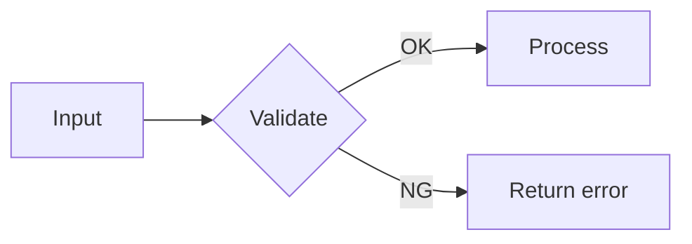

# Documentation Guideline

How documents in this repository are written.
They are meant to be published and shared, so the assumed reader is an outsider who does not know the
context.

## 1. One theme per file

A file covers one theme.
When design and operating procedures are mixed, one half gets updated and the content drifts.
When a file grows, split it and link the parts to each other.

## 2. Open with what the document is for

Right after the title, in two or three lines, say:

- the question this document answers,
- who it is for,
- what the reader will know at the end.

Do not open with a table of contents. Readers look for the conclusion, not the contents.

## 3. Record decisions with their reasons

The part of a design document that rots least is why it was decided.
Record not only the adopted option but **the rejected options and why**.

```text
Adopted: approach A
Reason: approach B is lighter to build at first, but later cannot meet constraint C
Revisit when: constraint C goes away
```

With "revisit when" written down, a later reader can judge for themselves whether the decision may be
overturned.

## 4. Do not name too much

This is a public repository, so it does not contain:

- private repository names (former names included), internal host names, project IDs,
- credentials, tokens, personal information,
- anything that reads as an evaluation of a specific person.

When a concrete example is needed, use a generic name that conveys the role (`api-server`,
`batch-worker`, "the music service", "the infrastructure repository").

## 5. Do not copy lists by hand

Lists of files or code items copied into a document always drift from the real thing.
Write **how to get the list** instead of the list.

```bash
# Example: get the list of settings with grep
grep -rn "config." ./src
```

## 6. Draw a diagram only when it shows the mechanism

No diagrams just for looks.
Draw relations or orders that would take long to explain in prose. In Markdown, use Mermaid.



## 7. Leave a trail of changes

When replacing content, make the change traceable by either:

- saying what changed in the commit message, or
- keeping a changelog at the end of the document (only for major changes of direction).

Write dates as absolute dates such as `2026-08-31`, not "last month" or "recently". A relative
expression has always changed meaning by the time it is read.

## 8. File names

- Lower-case English letters and hyphens only (`documentation-guideline.md`).
- No Japanese, spaces or upper case (awkward in URLs and on the command line).
- When the content changes, change the file name too. Replacing only the content breaks what the links
  promise.

## 9. Language

Documents under `docs/` are written in English and have no Japanese copy. The top-level `README.md` has
a Japanese copy, `README.ja.md`, changed in the same commit. Japanese appears in `docs/` only as quoted
data (a UI label, a prompt fragment), with an English gloss. The rule for the other repositories is in
[library-readme-convention.md §2.7](library-readme-convention.md#27-languages).

## Checklist

Check before publishing:

- [ ] The purpose and the intended reader are stated at the top
- [ ] Design decisions come with their reasons
- [ ] No private names or credentials
- [ ] No lists copied by hand
- [ ] No relative dates
- [ ] Relative links and anchors resolve
- [ ] `README.md` and `README.ja.md` were changed together
